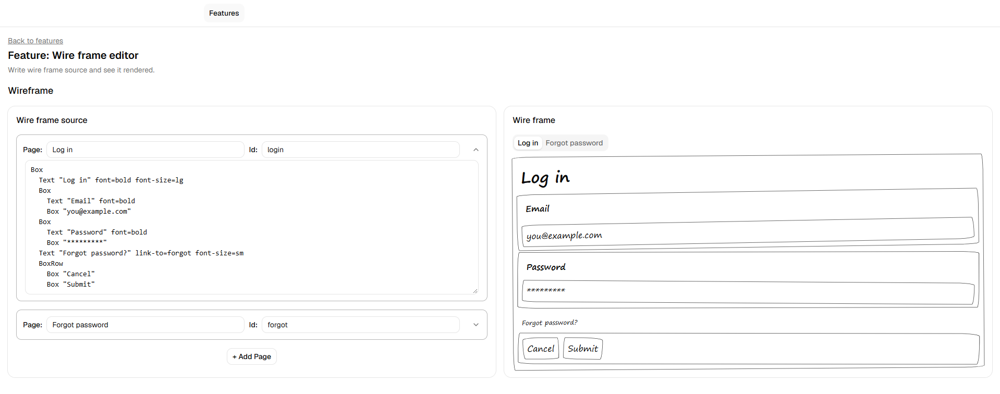

# Trellis

Just a wee minimalistic wire frame tool for now, but much more planned...

## Demo

https://trellis-ai.netlify.app/features (open a feature to edit its wire frame)



## Routes

| Route | Page |
| --- | --- |
| `/features` | The features page (list, with each name linking to its details page) |
| `/features/:id` | A feature's details page, with its wire frame source editor and preview (`Feature not found` for an unknown id) |
| `/` and any unknown path (including the removed `/wireframe-demo`) | Redirect to `/features` |

Every feature has its own wire frame source, edited on its details page and saved automatically to the mock API (in memory, so it is lost on reload). The three seeded features each have a sample wire frame (`src/features/wireframes/`).

The wire frame preview is drawn like a hand-made sketch. The look is deterministic, seeded by each node's position in the tree, not its text.

The app uses client-side routing (`react-router`); `public/_redirects` (`/* /index.html 200`) makes deep links work on Netlify.

There is no backend yet: the data comes from a mock API (`src/features/api.ts`).

## Prerequisites

- **Node.js** `^22.12.0` or `^24.0.0` (24 LTS recommended). This is the range required by Vitest 5; Vite 8 needs `^20.19.0 || >=22.12.0`.
- **pnpm** `10.x` (developed with 10.29.3). This repo uses pnpm only; do not use npm, yarn or bun.

## Setup

```sh
pnpm install
```

## Run

```sh
pnpm dev
```

Starts the Vite dev server (default http://localhost:5173, which opens the features page). Open a feature from the list (e.g. http://localhost:5173/features/seed-1) and write wire frame source in the page panes on the left (one per page, `+ Add Page` adds another) to see the wire frame on the right; syntax errors are shown under their pane with their line number.

## Syntax

Wire frames are authored in a minimal, indentation-sensitive syntax that is parsed into the JSON AST (`src/syntax/parse.ts`, validated by `AstSchema`):

```
Page "Log in" id=login
  Box
    Text "Log in" font=bold font-size=lg
    Box
      Text "Email" font=bold
      Box "you@example.com"
    Box
      Text "Password" font=bold
      Box "*********"
    Text "Forgot password?" link-to=forgot font-size=sm
    BoxRow
      Box "Cancel"
      Spacer
      Box "Submit"
Page "Forgot password" id=forgot
  Text "Enter your email"
  Box "you@example.com"
  Text "Back to log in" link-to=login
```

- One node per line: `<Type> [text] [attribute]`, where `Type` is `Page`, `Box`, `Text`, `Row`, `BoxRow` or `Spacer`. `Text` is like `Box` but has no border; `Row` lays its children out left to right on a single row, never wrapping, with no border; `BoxRow` is a `Row` with a border (like `Box` is to `Text`). `BoxRow` takes the same attributes and follows the same rules as `Row` (`width` yes, `link-to` and `id` no). Type names are case-sensitive (`boxrow` and `Boxrow` are errors).
- `Spacer` is invisible and expands to fill all the remaining space in its `Row` or `BoxRow` (several spacers in a row share it equally), so `Text "A"`, `Spacer`, `Text "B"` puts A at the left and B at the right, and a `Spacer` before an element pushes it to the right. It is written alone on its line and is only valid as a direct child of a `Row` or `BoxRow`; it cannot have text, `link-to`, `id` or children, but it can have `width` (`Spacer width=2`). Errors: `Spacer must be inside a Row or BoxRow`, `Spacer cannot have text`, `Spacer cannot have link-to` (or `id`) and `Spacer cannot have children`.
- `width=N` (a whole number from 1 to 12) sets a child's share of its parent `Row` or `BoxRow` in twelfths (`Box "Email" width=3` is a quarter of the row); siblings without one count as 3 once any sibling has a width, and widths need not add up to 12. It is ignored outside a `Row` or `BoxRow` and not allowed on `Page`.
- `font=bold` and `font-size=sm|md|lg` (`md` is the default) style a node's own text, e.g. `Text "Log in" font=bold font-size=lg`; they are not inherited by children. They are allowed on `Box`, `Text`, `Row` and `BoxRow` only, and the values are case-sensitive.
- `Page` is the only root-level component: every line with no indentation must be a `Page`, and a `Page` can never be nested. The title is mandatory (`Page "Log in"`; `Page ""` is allowed and gives an empty title). A page's children are `Row`, `BoxRow`, `Box` or `Text` nodes, and a page may have none.
- A source must contain at least one page and may contain several pages, one after another, each with no indentation.
- Nesting is expressed by indentation only: exactly 2 spaces per level. Tabs, odd indentation and skipped levels are errors.
- Blank lines are ignored. Empty or whitespace-only source is a blank wire frame (one page with an empty title and no children), not an error.
- The preview shows one tab per page, labelled with the page's title (`Page N` when the title is empty); tabs are shown even for a single page. The first page is selected initially, only the selected page is rendered, and the selected tab is kept by position while you edit (falling back to the last page if its position no longer exists).
- A line can end with `key=value` attributes after the optional text, each separated by one space; the value is bare (letters, digits, `-` and `_`, or a number for `width`) and each key may appear once. `Page` takes `id` (`Page "My Page" id=test-id`, unique across pages), `Box` and `Text` take `link-to` (`Text "My Link" link-to=test-id`, text may be omitted: `Box link-to=test-id`) and `Box`, `Text`, `Row`, `BoxRow` and `Spacer` take `width` (see above) and `Box`, `Text`, `Row` and `BoxRow` also take `font` and `font-size` (see above). `id` is not allowed on `Box`, `Text`, `Row`, `BoxRow` or `Spacer`, and `link-to` is not allowed on `Page`, `Row`, `BoxRow` or `Spacer`. Unknown attributes, duplicate keys, bad values and duplicate page ids are errors.
- A node with `link-to` is a link in the preview: it shows a pointer cursor and clicking it opens (selects the tab of) the page with that id. Only the innermost of nested links reacts. A `link-to` naming a page that does not exist is not a syntax error; clicking it shows a "Page not found" toast and leaves the selected tab unchanged.
- Text is either a double-quoted string (`Box "Some Text"`) or omitted where allowed (e.g. `Box`, meaning `""`). `""` is valid. Bare unquoted text (`Box Some Text`) is an error. There are no escape sequences, so text cannot contain a `"`, and nothing may follow the closing quote.
- Parsing fails fast with the first error, reported with a 1-based line number (e.g. `Line 3: Unknown type "Button" ...`).

## Test

```sh
pnpm test        # run the Vitest suite once
pnpm typecheck   # type-check with tsc
```

## Build

```sh
pnpm build       # outputs to dist/
pnpm preview     # serve the production build locally
```
